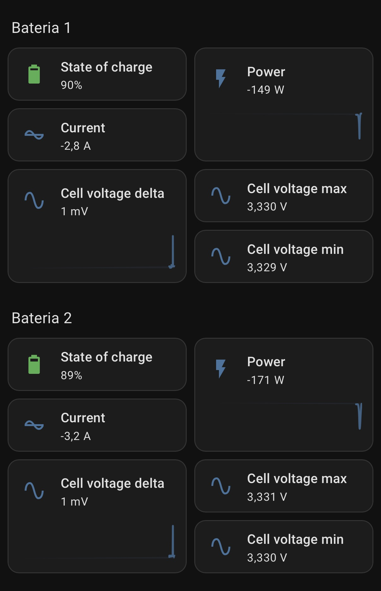

# felicity-battery-modbus

RS485 / Modbus RTU protocol documentation and tooling for **Felicity Solar LiFePO4 batteries**
(FLB48314TG1, and other 48 V packs that speak the **Voltronic "LIB" BMS protocol**: FLB48100,
LPBF48, LPBA48 family), with the goal of reading the packs directly from
**Home Assistant** (MQTT discovery) and, later, from an **ESPHome** device.

> Status: protocol decoded and verified on hardware (3 packs in parallel). `felicityd` (Go daemon,
> MQTT + Home Assistant discovery) is released ([v1.0.0](https://github.com/KrzysztofHajdamowicz/felicity-battery-modbus/releases/latest))
> and runs in production on a Raspberry Pi 5 next to Solar Assistant. The ESPHome component is
> planned, see *Roadmap*.

## What is in here

| Path | Contents |
|---|---|
| [`docs/protocol.md`](docs/protocol.md) | Full protocol description: wiring, framing, the non‑standard response header, register map, scaling, derived metrics, pack discovery, polling plan. |
| [`docs/felicity-battery-registers.pdf`](docs/felicity-battery-registers.pdf) | The register map as a printable PDF. |
| [`docs/voltronic-inverter-bms-485-protocol-20201202.docx`](docs/voltronic-inverter-bms-485-protocol-20201202.docx) | The original Voltronic Power document *"Inverter and BMS 485 communication Protocol"* (2020‑03‑25) that the batteries implement, plus a plain‑text extract. |
| [`cmd/felicityd`](cmd/felicityd), [`internal/`](internal/) | **felicityd**: Go daemon that enumerates the packs, polls them over a USB‑RS485 adapter and publishes to MQTT with Home Assistant discovery. See *felicityd* below. |
| [`deploy/`](deploy/) | systemd unit and `/etc/default/felicityd` template. |
| [`tools/felicity_decoder.py`](tools/felicity_decoder.py) | Reference decoder in Python: request builder, response validator (handles the non‑standard header), register map, derived metrics, bus‑capture parser, self‑test. |
| [`captures/`](captures/) | Raw RS485 traffic from a live system (3 × FLB48314TG1 at addresses 1–3). Also the fixture for the Go tests and for `felicityd -replay`. |

## Protocol in one paragraph

Modbus RTU, **9600 8N1**, function **0x03** only. Requests are standard 8‑byte frames. **Responses
are not standard:** after the address and function code the battery sends a **16‑bit register
count** instead of the 8‑bit byte count, so off‑the‑shelf Modbus stacks (pymodbus, tmodbus,
ESPHome `modbus_controller`) reject every frame as a length/CRC error. The register layout follows
the Voltronic document: cell count and 20 cell voltages from register 16, temperature count and
10 NTC readings (0.1 K) from 37, charge/discharge current (0.1 A), pack voltage, SOC and capacity
(mAh) at 48–53, charge/discharge limits and status bits at 112–116. Felicity deviates from the
document by reporting cell and pack voltage in **mV** rather than 0.1 V.

Example exchange (address 1, registers 37..53):

```
TX  01 03 00 25 00 11 94 0D
RX  01 03 00 11  00 04  0B C4 0B C4 0B C4 0B BA  00 00 00 00 00 00 00 00 00 00 00 00  00 00  00 13  D0 A2  00 5F  00 05 57 30  <CRC>
          ^^^^^ 17 registers (not a byte count)
```

→ 4 sensors, 28.1 / 28.1 / 28.1 / 27.1 °C, charge 0.0 A, discharge 1.9 A, 53.41 V, SOC 95 %, 350.0 Ah.

## Hardware notes

- Battery communication port: RS485 on pins 5 (B) and 6 (A) of the RJ45 socket, CAN on 7–8
  (see the vendor's inverter connection guides). A plain USB‑RS485 dongle works.
- Pack address is set with the DIP switches on each pack (1, 2, 3, …). The master polls each
  address separately; the packs do not aggregate.
- Only **one master** may be on the bus. If an inverter already reads the packs over RS485, use
  the inverter's data instead, or move the inverter to CAN.

## felicityd

<p align="center">
  
</p>

A single static binary for Linux (Raspberry Pi 5 / arm64, amd64, armv7) that:

1. enumerates the packs (addresses 1, 2, … until the first one that does not answer, or the list
   in `FELICITYD_PACK_ADDRESSES`), detects the mV / 0.1 V scaling and probes the optional
   version and alarm registers,
2. polls the status, cell and limit blocks on separate intervals (defaults 5 s / 30 s / 60 s per
   pack), repairs frames that lost their address byte on the wire and counts the rest as bus
   errors,
3. publishes one retained JSON document per pack and one for the whole bank, plus Home Assistant
   **device discovery** payloads: one HA device per pack and a *Felicity Battery System* device
   with the totals. Availability is tracked per pack and for the daemon (MQTT last will).

### Install on a Raspberry Pi

```bash
# on your workstation (Go installed): build for arm64, copy binary + unit, enable the service
make deploy PI_HOST=pi@raspberrypi.local

# on the Pi, once: configuration
sudo cp deploy/felicityd.env.example /etc/default/felicityd   # or scp it over
sudo editor /etc/default/felicityd                             # MQTT host, credentials, serial port
sudo systemctl restart felicityd
journalctl -u felicityd -f
```

Or download `felicityd_<version>_linux_arm64.tar.gz` from the
[release page](https://github.com/KrzysztofHajdamowicz/felicity-battery-modbus/releases/latest), which
contains the binary, the unit and the environment template. It coexists with Solar Assistant on the
same Pi as long as each gets its own RS485 adapter (or its own port of a dual adapter). Before
enabling the service, check what the daemon sees on the bus:

```bash
FELICITYD_SERIAL_PORT=/dev/serial/by-id/usb-...-port0 felicityd -scan
```

```
ADDR  ONLINE  CELLS  TEMPS  VOLTAGE  CURRENT  POWER  SOC   CAPACITY  TEMP     CELL MIN/MAX          I LIMITS (CHG/DIS)  SCALE (CELL/PACK)  FW  ALARM REGS
1     true    16     4      53.43 V  -0.3 A   -16 W  95 %  350.0 Ah  28.1 °C  3.342/3.343 (Δ 1 mV)  48/160 A            0.001/0.001        -   false
2     true    16     4      53.48 V  -1.2 A   -64 W  96 %  350.0 Ah  27.1 °C  3.340/3.344 (Δ 4 mV)  32/160 A            0.001/0.001        -   false
3     true    16     4      53.47 V  0.4 A    21 W   95 %  350.0 Ah  28.1 °C  3.343/3.343 (Δ 0 mV)  40/160 A            0.001/0.001        -   false
```

Other flags: `-dry-run` logs the MQTT messages instead of connecting, `-replay <capture>` answers
from a bus capture instead of the serial port (`make replay` runs both against `captures/`), `-version`.

### Configuration

Everything comes from `FELICITYD_*` environment variables (systemd `EnvironmentFile=/etc/default/felicityd`).
[`deploy/felicityd.env.example`](deploy/felicityd.env.example) documents every variable; the
important ones:

| Variable | Default | Meaning |
|---|---|---|
| `FELICITYD_SERIAL_PORT` | `/dev/ttyUSB0` | USB‑RS485 adapter (prefer `/dev/serial/by-id/...`) |
| `FELICITYD_PACK_ADDRESSES` | *(enumerate)* | e.g. `1,2,3` to skip enumeration |
| `FELICITYD_MQTT_HOST` / `_PORT` | – / `1883` (`8883` with TLS) | broker; **host is required** |
| `FELICITYD_MQTT_TLS`, `_TLS_INSECURE`, `_CA_FILE` | `false` | TLS settings |
| `FELICITYD_MQTT_USERNAME` / `_PASSWORD` | – | credentials |
| `FELICITYD_MQTT_TOPIC_PREFIX` | `felicity` | state topics: `felicity/pack/<n>/state`, `felicity/system/state`, `felicity/availability` |
| `FELICITYD_HA_DISCOVERY` / `_PREFIX` | `true` / `homeassistant` | publish discovery under `homeassistant/device/<id>/config` |
| `FELICITYD_SYSTEM_ID`, `_DEVICE_NAME`, `_PACK_MODEL` | `felicity`, `Felicity Battery`, `FLB48314TG1` | identifiers and names in Home Assistant |
| `FELICITYD_STATUS_INTERVAL`, `_CELLS_INTERVAL`, `_LIMITS_INTERVAL` | `5s`, `30s`, `60s` | polling periods per pack |
| `FELICITYD_ACCEPT_TRUNCATED_CRC` | `false` | also accept frames missing the last CRC byte (8‑bit check) |

### Home Assistant entities

Names are prefixed by the device name, so pack 1 becomes `sensor.felicity_battery_1_voltage` etc.
`unique_id`s are `<system_id>_pack_<n>_<key>` and `<system_id>_system_<key>` and will not change.

**Per pack (`Felicity Battery <n>`)**

| Entity | Class / unit | Notes |
|---|---|---|
| Voltage, Current, Power | voltage V, current A, power W | current and power are **positive when charging** |
| State of charge | battery % | attributes: address, cell/temperature sensor counts, scaling |
| Temperature | temperature °C | mean of sensors 1–3 |
| Remaining capacity | Ah | SOC × full‑charge capacity |
| Cell voltage delta | voltage mV | max − min cell, attributes with the cell indexes |
| Charging | binary, `battery_charging` | |
| *Diagnostic:* Full charge capacity, Cell voltage min / max / average, Charge / Discharge voltage limit, Charge / Discharge current limit, Bus errors | | min/max carry the cell index as attribute |
| *Diagnostic:* Charge enabled, Discharge enabled, Charge immediately request, Full charge request, Small current charge request | binary | bits of register 0x74 |
| *Diagnostic, disabled by default:* Cell 1…N voltage, Temperature sensor 1…M (sensor 6 = MOSFET), Charge current, Discharge current, BMS status register | | enable in the entity settings when needed |
| *Diagnostic, only if the firmware implements registers 54–60:* Charge alarm, Discharge alarm, Charge protection, Discharge protection | binary, `problem` | attribute `flags` lists the active bits by name |

**System (`Felicity Battery System`)**

Power, Current (sums), Voltage (mean), State of charge (capacity‑weighted), Temperature (mean) and
Temperature max (with pack/sensor attributes), Stored energy (`energy_storage`, kWh, from the
nominal voltage), Remaining / Full charge capacity (Ah), Charge / Discharge current limit (sum over
packs that allow it), Charge voltage limit (min) / Discharge voltage limit (max), Charging.
Diagnostic: Packs online (with the address lists as attributes), Cell voltage min / max / delta
across all packs, Charge / Discharge enabled (all packs), Charge immediately request (any pack),
Problem (any alarm or a configured pack offline), Bus errors.

Energy (kWh charged / discharged) is deliberately left to Home Assistant: add a *Riemann sum
integral* helper on the Power sensors and feed it to the Energy dashboard.

### Development

```bash
make test            # go test -race ./...
make scan            # enumerate the packs in the recorded capture
make replay          # full daemon against the capture, MQTT messages logged
go test ./internal/ha -update   # refresh the discovery golden files after an intended change
```

CI builds linux/amd64, linux/arm64 and linux/armv7 on every push; a `v*` tag publishes a GitHub
release with tarballs and `SHA256SUMS`. Dependabot assigns every update to the maintainer and
auto‑merges patch releases once CI is green (requires *Allow auto‑merge* and a branch protection
rule on `main` that requires the *Test and lint* check).

## Roadmap

1. ~~`felicityd`~~ — done and running 24/7 on a Raspberry Pi 5 with three FLB48314TG1 packs,
   zero bus errors so far. Ideas for later: energy counters, periodic re‑scan for packs added at
   runtime.
2. ESPHome external component (C++) for an ESP32 with an RS485 transceiver, generating the
   sensors from a `packs:` option instead of hand‑written YAML.
3. Verify the alarm / protection registers (0x36–0x3C) and the remaining‑capacity registers
   (0x75–0x77) from the Voltronic document on Felicity firmware. `felicityd` already reads them
   when the pack answers and exposes them as *problem* binary sensors.

## Quick check with the reference decoder

```bash
uv run tools/felicity_decoder.py --selftest
uv run tools/felicity_decoder.py captures/2026-10-10-rs485-bus.log
uv run tools/felicity_decoder.py --request 1 37 17     # prints the request frame in hex
```

## License

MIT, see [LICENSE](LICENSE). The Voltronic document in `docs/` is the property of Voltronic Power
and is included for reference.
